<picture>
  <source media="(prefers-color-scheme: dark)" srcset="assets/banner-dark.svg">
  
</picture>

 

 

I'm a backend developer with **3+ years** of experience building eCommerce, mobile and workflow-automation systems. I work mostly in **PHP** (Laravel, CodeIgniter, OpenCart) with **MySQL**, and I care about the parts users never see: payments that bill correctly, fast queries, tidy APIs and code that is safe to change.

|  |  |
| --- | --- |
| **Now** | Web Developer at Tekshapers Software Solutions, Noida (since May 2023) |
| **Education** | Master of Computer Applications, IGNOU (2023 – 2025) |

 

## What I build

<table>
  <tr>
    <td width="50%" valign="top">
      <b>REST APIs</b> 
      OAuth, rate limiting, batching and pagination tuned for speed.
    </td>
    <td width="50%" valign="top">
      <b>Payments and billing</b> 
      Stripe, PayPal and Redsys: subscriptions, recurring payments and webhooks.
    </td>
  </tr>
  <tr>
    <td valign="top">
      <b>Business integrations</b> 
      Zoho Books, Zoho Inventory and delivery services for accounting, orders and logistics.
    </td>
    <td valign="top">
      <b>Real-time and automation</b> 
      WebSockets, Playwright scripts, cron jobs and multi-channel notifications.
    </td>
  </tr>
</table>

 

## Stack

| | |
| --- | --- |
| **Backend** |      |
| **Database** |    |
| **Payments** |    |
| **Integrations** |      |
| **Frontend and mobile** |       |
| **Tools** |       |

 

## Selected work

| Project | What it does | Built with |
| --- | --- | --- |
| **E-Commerce & Subscription Platform** | Large-scale OpenCart store with custom checkout, subscription billing and recurring payments. Syncs orders, stock and invoices with Zoho. Includes GDPR workflows, audit logs and automatic translation for a multilingual storefront. | PHP, OpenCart 3, MySQL, Stripe, Zoho, Google Translate API |
| **Field Data Collection & Water Conservation Platform** | Offline-first mobile app and backend for an NGO's water conservation programmes across India. Handles 100+ interconnected forms and syncs automatically when the connection returns. | Ionic, Angular, Cordova, CodeIgniter 3, MySQL |
| **HRMS & Client Collaboration Platform** | Message boards, files, tasks and real-time notifications for client collaboration, plus Full & Final clearance workflows with parallel and sequential approvals. | PHP, CodeIgniter, MySQL, WebSockets |
| **[Chrome Ad Blocker Extension](https://github.com/vishalhere004/add-blocker)** | Personal project: a Chrome extension that blocks ads, speeds up pages and cuts distractions. | JavaScript, Chrome APIs |
| **School Management System** | Web app for student enrollment, attendance tracking and fee management. | PHP, MySQL, CodeIgniter |

 

### Let's build something

Need a backend developer for your next project? **[Send me an email](mailto:vishalpahadi4287@gmail.com)** or find me on **[LinkedIn](https://linkedin.com/in/vishal-pant-a7368220a)**.

